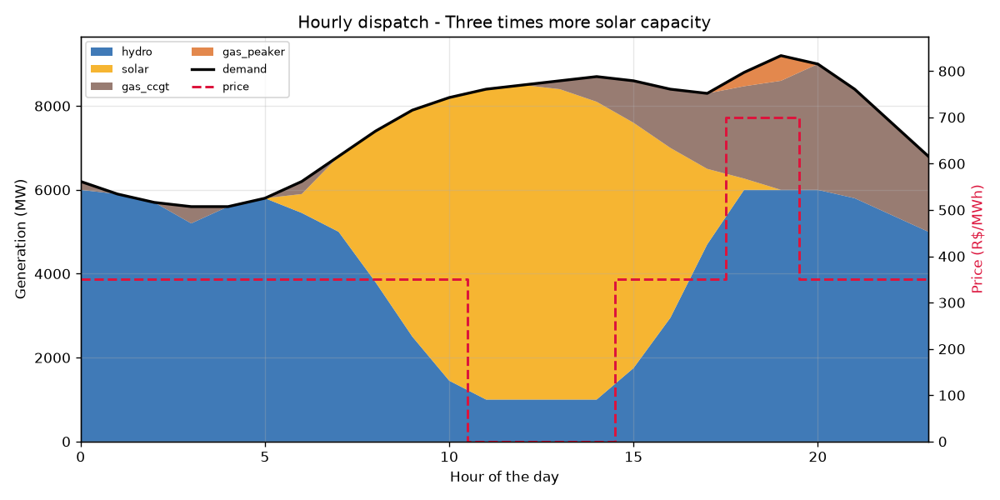
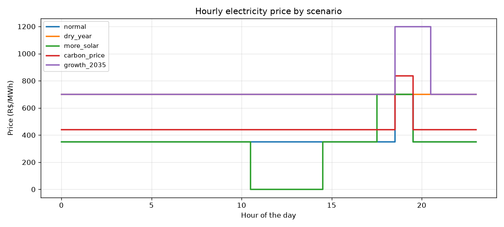

# Brazil Power Dispatch

Least-cost hourly power dispatch and capacity expansion for a stylised Brazilian power system, written in Python with [Pyomo](https://www.pyomo.org/) and the open-source [HiGHS](https://highs.dev/) solver.

The model answers three questions that power market models answer every day:

1. **Dispatch:** which plants should run each hour to meet demand at the lowest cost?
2. **Prices:** what is the electricity price in each hour, and how much is the water in the reservoirs worth?
3. **Expansion:** demand is growing, so what should be built next?



*With three times more solar, hydro drops to its minimum ecological flow at midday and saves the water for the evening peak. The midday price falls to zero.*

---

## Results

All numbers come from **illustrative** input data (see [Data](#data)), so the shapes and relationships matter more than the values.

| Scenario | Avg price (R$/MWh) | Peak price | Water value | Daily cost (R$ m) | CO₂ (kt/day) |
|---|---:|---:|---:|---:|---:|
| Normal year | 368 | 700 | 340 | 22.2 | 22.4 |
| Dry year (40% less water) | **700** | 700 | **690** | 45.6 | 42.2 |
| 3× more solar | 319 | 700 | 340 | **8.8** | **8.0** |
| Carbon price R$250/t | 463 | 838 | 433 | 27.8 | 22.4 |
| Demand +30% (2035) | 750 | **1,200** | 690 | 56.3 | 50.1 |

What the model shows:

- **The price is set by the last plant needed.** In a normal year the combined-cycle gas plant is marginal most of the day (R$350). At the 19:00 peak, after the sun sets, the peaker sets the price (R$700).
- **Water has a price.** Hydro costs almost nothing to run, but the water is limited, so the model values it at what it saves: the cost of the gas it replaces. That is the *water value*, the core idea behind how Brazil prices electricity.
- **A drought doubles the price.** With 40% less water, more expensive gas must run all day and the water value rises with it.
- **Solar plus hydro work as a team.** Hydro acts like a giant battery: it holds back water while the sun shines and releases it in the evening.
- **A carbon price raises prices but not, by itself, emissions.** In the short run there is no cleaner plant to switch to. Emissions fall when investment decisions change.

### Expansion: what to build for 2035

With demand 30% higher, the integer model (MIP) chooses whole 500 MW units:

| Build | Units | MW | Cost per year (R$ m) |
|---|---:|---:|---:|
| New solar | 18 | 9,000 | 4,506 |
| New combined-cycle gas | 3 | 1,500 | 976 |

The investment costs **R$5.5 bn a year** and saves **R$12.7 bn a year** in fuel, a net benefit of R$7.2 bn. The average price falls from R$750 to R$345/MWh (−54%) and emissions fall by 58%.



---

## How it works

### Formulation

**Sets:** hours $t$, existing plants $g$, candidate plants $c$.
**Decisions:** generation $p_{g,t}$ and $q_{c,t}$ (MW), unserved demand $u_t$, and units to build $n_c \in \{0, 1, \dots, N_c\}$.

$$
\min \; \sum_c A_c S_c n_c \;+\; W \sum_t \Big[ \sum_g (v_g + \tau e_g)\, p_{g,t} + \sum_c (v_c + \tau e_c)\, q_{c,t} + \text{VOLL}\cdot u_t \Big]
$$

subject to

| Constraint | Meaning |
|---|---|
| $\sum_g p_{g,t} + \sum_c q_{c,t} + u_t = D_t$ | Demand is met every hour. Its dual $\lambda_t$ is **the price**. |
| $p_{g,t} \le K_g\, a_{g,t}$ and $q_{c,t} \le n_c S_c\, a_{c,t}$ | Capacity, scaled by availability (solar follows the sun). |
| $p_{g,t} \ge P^{\min}_g$ | Minimum output, e.g. the ecological flow below a dam. |
| $\lvert p_{g,t} - p_{g,t-1} \rvert \le R_g$ | Ramp limits: thermal plants change output gradually. |
| $\sum_t \sum_{g \in \text{hydro}} p_{g,t} \le E$ | Water budget. Its dual $\mu$ is **the water value**. |

$v$ = variable cost, $e$ = emissions, $\tau$ = carbon price, $K$ = capacity, $S$ = unit size, $A$ = annualised cost per MW (capex × capital recovery factor + fixed O&M), $W$ = 1 for dispatch or 365 for expansion.

### Two models, one builder

- **Dispatch** is a linear program (LP). Prices come straight from the duals.
- **Expansion** adds integer build decisions, which makes it a mixed-integer program (MIP). Integer problems have no duals, so after solving the MIP the model **fixes the build decisions and re-solves the LP** to read the prices. This is standard practice in capacity expansion tools.

### Why hydro matters in Brazil

Hydropower supplies most of Brazil's electricity. Because rain is uncertain, the official short-term price is calculated by hydro-thermal optimisation models (the NEWAVE, DECOMP and DESSEM chain) that compare using water now with saving it for later. This project models a single day with a fixed water budget, which is the simplest version of that trade-off.

---

## Quick start

```bash
python -m venv .venv
.venv\Scripts\activate            # Windows  (Linux/macOS: source .venv/bin/activate)
pip install -e ".[dev]"

python -m dispatch compare                       # every scenario side by side, charts in results/
python -m dispatch run --scenario dry_year       # one scenario, hour by hour
python -m dispatch expand --scenario growth_2035 # what should be built?
python -m dispatch -v compare                    # with logging

pytest                                           # run the tests
```

With Docker:

```bash
docker build -t power-dispatch .
docker run --rm power-dispatch compare
```

## Project structure

```
data/
  system.yaml            plants, water budget, investment candidates
  hourly_profiles.csv    demand and solar availability for each hour
  scenarios.yaml         what-if changes to the base system
src/dispatch/
  data.py                validated input classes and loader
  scenarios.py           applies a scenario without changing the base data
  model.py               Pyomo model, solve, prices and water value
  plots.py               charts
  __main__.py            command line interface
tests/                   pytest suite: hand-checkable cases, physical rules, economics
```

## Testing

The suite has three layers:

1. **Small cases solvable by hand.** For example: with demand of 80 MW, a full 50 MW plant at R$10 and a second plant at R$30, the price must be exactly R$30.
2. **Physical rules on the full system.** Demand is met, capacities, ramps, the water budget and the ecological flow are never broken.
3. **Economic sanity.** A drought must raise prices, more solar must lower midday prices, investment must lower total yearly cost, and builds come in whole units.

Tests run automatically on every push with GitHub Actions.

## Data

All inputs are **illustrative**: realistic in shape (a typical Brazilian daily demand curve, a solar profile, plausible costs in R$), but not official data. They live in plain YAML and CSV files so anyone can change them without touching the code.

## Limitations and next steps

This is a deliberately small model. The main simplifications, and how I would extend it:

| Simplification | Next step |
|---|---|
| One representative day | Several representative days or weeks, weighted by how often they occur |
| A single daily water budget | Reservoir levels hour by hour, inflows, cascades of plants on the same river |
| Known future (deterministic) | Inflow scenarios (stochastic optimisation), as in the official Brazilian models |
| No transmission | Brazil's four subsystems (SE/CO, S, NE, N) connected by transmission limits |
| No start-up costs | Unit commitment (on/off decisions, minimum up and down times) as a MIP |
| Illustrative data | Real hourly load from the ONS open data portal |
| No storage | Batteries as an investment candidate |

---

Built by **Lucas Toledo Fernandes** · [LinkedIn](https://www.linkedin.com/in/lucastfernandes/)
Developed with AI-assisted tooling (Claude Code); every modelling choice is tested and documented.

Licensed under the MIT License.
